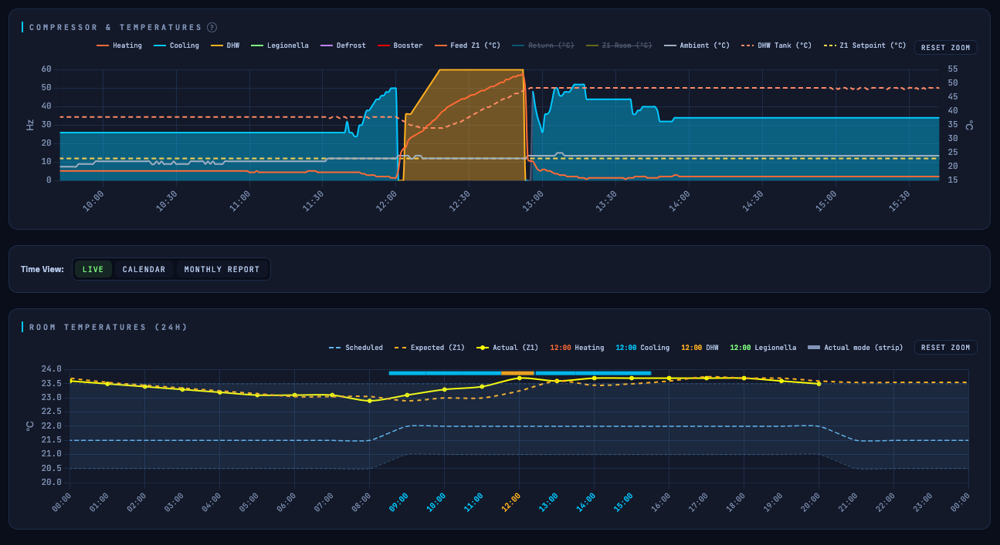

# ODIN — Heat Pump Cost Optimizer

ODIN decides **when** your heat pump runs. It optimizes the upcoming hours against your actual electricity prices and solar (PV) forecast, keeps your home comfortably within your target temperature range, and learns the thermal physics of your building — heat loss, COP, thermal time constant, and tank standing loss — directly from the heat pump's own sensors rather than relying on generic factory tables.

Everything runs locally on the device. There is no cloud account, no subscription, and no data leaving your local network. ODIN only *pulls* day-ahead energy prices and weather forecasts — both of which you can also push from your own home automation system instead. Calculating an optimal schedule takes a fraction of a second and runs once an hour, producing a transparent, hour-by-hour plan that explains why it decided to heat or hold off.

[-Buy_via_Stripe_Checkout-635BFF?style=for-the-badge&logo=stripe&logoColor=white)](https://buy.stripe.com/6oU6oI2OVeQX7BBgJc4AU03)

---

## Background: Why ODIN?

This project started with [`esphome-ecodan-hp`](https://github.com/gekkekoe/esphome-ecodan-hp), an open-source integration born out of reverse-engineering the Mitsubishi Ecodan communication protocol. Once full local readout and control of the heat pump were unlocked, the next challenge quickly became obvious: **how to actually control it smartly**. 

With the phase-out of net metering (*salderingsregeling*) here in the Netherlands and the rise of dynamic energy tariffs, simply keeping a steady room temperature is no longer enough. If you have solar panels, you want to maximize self-consumption and use your home's thermal mass as a battery. 

When looking for a solution that could truly optimize this, it turned out that proper **Model Predictive Control (MPC)** is normally reserved for large commercial buildings and industrial HVAC systems — coming with enterprise price tags and expensive consultancy fees. For the residential market, true MPC software simply did not exist, especially not something that runs **100% locally without relying on a cloud service** or recurring subscriptions. 

Building a reliable, self-learning MPC solver that handles real-world building physics, weather forecasts, and heat pump quirks is far beyond the scope of a weekend hobby project. Developing, testing, and maintaining ODIN is a dedicated, full-time engineering effort — built from the ground up to bring enterprise-grade energy optimization to your home without sacrificing your privacy.

---

### Supported Heat Pumps Matrix

| Brand / System | Protocol | Bridge / Interface | ODIN Version | Status |
|---|---|---|---|---|
| **Mitsubishi Ecodan / Zubadan** | MQTT | [Asgard](https://github.com/gekkekoe/esphome-ecodan-hp/tree/main/asgard) (Virtual Thermostats) | ODIN 2.0 | ✅ Supported |
| **Panasonic Aquarea** | MQTT | HeishaMon | ODIN 2.0 |  ✅  Supported |
| **Adlar Castra** *(Aurora II)* | Modbus TCP | Native / RS485-to-TCP gateway | ODIN 2.0 | 🧪 Beta |
| **Daikin Altherma** | MQTT | ESPAltherma / P1P2MQTT | ODIN 2.0 | 🧪 Beta |
| **Daikin Altherma** | Modbus TCP | Daikin DCOM / HomeHub | ODIN 2.0 | 🧪 Beta |
| **Vaillant aroTHERM** | MQTT | ebusd (eBUS) | ODIN 2.0 | 🧪 Beta |
| **NIBE** | Modbus TCP | Native Modbus TCP (S-Series / SMO) | ODIN 2.0 | 🧪 Beta |
| **Luxtronik** *(Alpha Innotec / Novelan)* | Modbus TCP | Native Modbus TCP | ODIN 2.0 | 🧪 Beta |

> 💡 **Is your heat pump not listed?** If your heat pump can be read and controlled locally via MQTT or Modbus TCP, we can likely add support for it! Feel free to reach out via [Discussions](https://github.com/gekkekoe/esphome-ecodan-hp/discussions) to request integration for your specific model.

## Which manual & hardware do you need?

| Feature | **ODIN 2.0** | **ODIN 1.0** |
|---|---|---|
| **Manual** | [manuals/odin-2/README.md](manuals/odin-2/README.md) | [manuals/odin-1/README.md](manuals/odin-1/README.md) |
| **Connection** | Connects directly to the heat pump via **MQTT** or **Modbus TCP**. | Connects via the **Asgard** dashboard alongside the pump, using wired virtual thermostats. |
| **Interface** | Standalone web dashboard (*Monitoring, Settings, Data, System*). | The *Solver* tab inside the Asgard interface. |
| **Typical setup** | Any supported heat pump speaking MQTT or Modbus natively or via a bridge. | Existing Asgard / Ecodan setups that already control the heat pump. |

> **Tip:** Start with the *Getting Started* section in your manual. It walks you through the first boot, the setup wizard, and each configuration setting step by step.

---

## How ODIN optimizes

* **Energy Prices** — Supports dynamic day-ahead tariffs (Energy-Charts or ENTSO-E, including local energy taxes and VAT), fixed rates, or custom price tables pushed via the API. Supplier markups, "cheap hour" thresholds, and maximum price caps are all evaluated against the *effective* electricity cost — meaning solar-covered hours can easily stay below a price ceiling that the raw grid tariff would otherwise exceed.
* **Weather & Solar** — Pulls forecasts from Open-Meteo, Visual Crossing, or your own local feed. You can configure capacity, orientation, tilt, efficiency, and morning/evening shading per solar array to get an accurate hourly PV estimate — turning sunny midday hours into virtually free heating windows.
* **Building Physics** — Continuously learned and updated daily: heat loss (in kW/K), heating and cooling COP, the building's thermal time constant, passive solar gain through windows, and the standing heat loss of your domestic hot water (DHW) tank. Every learned parameter is visible in the *Monitoring* tab and can be manually overridden at any time.
* **Hot Water & Hygiene** — DHW runs are scheduled just like space heating: shifted into the cheapest or sunniest hours based on tank volume and real-time energy costs. Legionella cycles are either actively scheduled the same way, or accounted for automatically when managed by the heat pump itself.
* **Custom Constraints** — Set hourly caps on electrical power draw or thermal output, enable an optional buffer/mixing tank model, manage two independent heating zones, and utilize smart home-battery recommendations based on state of charge (SoC) and maximum discharge rates.

---

## Repository structure

| Path | Description |
|------|----------|
| [`manuals/odin-2/`](manuals/odin-2) | Current manual and screenshots for the ODIN 2.0 device. |
| [`manuals/odin-1/`](manuals/odin-1) | Legacy manual for the ODIN 1.0 device and Asgard integration. |
| [`docs/`](docs) | Source files for the product website hosted on GitHub Pages. |
| [`automations/`](automations) | Home Assistant blueprint that forwards HA sensor data (battery SoC, room temperature overrides, discharge limits) to ODIN via its REST API. |

The REST and MQTT APIs are fully documented in sections 20 and 21 of the [ODIN 2.0 manual](manuals/odin-2/README.md). Use these endpoints to integrate the Home Assistant blueprint, forward external room sensors, or push your own custom price feeds.

---

## License and Warranty

When you purchase ODIN, **what you are really buying is the software license**. The license comes pre-installed on the ODIN hardware required to run it. Hardware carries a **1-year warranty** against manufacturing defects (voided by physical modification, water exposure, lightning strike or accidental damage). If your board ever dies outside of warranty, your software license remains yours: simply **return the defective unit to us**, and we will exchange it for a replacement board at our hardware cost price.

ODIN is provided strictly for **private residential use**. Commercial use or reselling the device as part of a commercial installation service is prohibited. We accept no liability for damage to your property or heating system; you are expected to monitor the system closely during the first few weeks of operation, particularly when active cooling is enabled. Full terms and conditions can be found in Section 3 of either manual.

## Questions & Support

Have a question or need help with your setup? Head over to the [Discussions tab](https://github.com/gekkekoe/esphome-ecodan-hp/discussions) on the heat pump bridge repository. That is where the community troubleshoots installations — from verifying initial telemetry to debugging specific heat pump dialects.